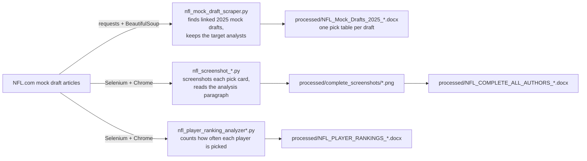

# NFL Mock Draft Scraper

Python scripts from June 2025 that collect NFL.com's 2025 first-round mock drafts by a set of analysts (Bucky Brooks, Daniel Jeremiah, Charles Davis and others) and put them in Word documents, so the picks can be read and compared in one place. The repo holds two approaches: a text scraper that writes each draft as a pick table, and Selenium tools that screenshot each pick card on NFL.com and place it in the document with the analyst's write-up underneath.

## Saved output


This image is one of the 362 captures in `processed/complete_screenshots/`. It shows the source material collected for the 2025 mock-draft documents, not current draft predictions. NFL.com owns the captured article content and imagery.

[Download a completed Word document](processed/NFL_COMPLETE_20250608_170704.docx) to see the June 8, 2025 output without rerunning anything: 7 analysts, a screenshot of each pick and the analysis text below it. The [saved source page](ref/Bucky%20Brooks%202025%20NFL%20mock%20draft%204.0_%20Steelers%20land%20Shedeur%20Sanders%3B%20Cowboys%2C%20Broncos%20select%20RBs.html) (and a [PDF](ref/Bucky%20Brooks%202025%20NFL%20mock%20draft%204.0%3A%20Steelers%20land%20Shedeur%20Sanders%3B%20Cowboys%2C%20Broncos%20select%20RBs.pdf) of it) is included for comparison.

## How it fits together



## Setup

Python 3 and the packages in `requirements.txt`. The scripts that draw or resize images (`complete_nfl_web_scraper.py`, `condensed_nfl_layout_creator.py`, `nfl_exact_replica_all_authors.py`, `nfl_screenshot_scraper.py`, `nfl_screenshot_webpage_creator.py`) also import Pillow, which isn't in `requirements.txt`:

```bash
python3 -m venv .venv
source .venv/bin/activate
pip install -r requirements.txt Pillow
```

The Selenium scripts drive Google Chrome, so Chrome has to be installed. Most of them open a visible browser window; the two ranking analyzers and `nfl_screenshot_scraper.py` run headless.

## The text scraper

```bash
python nfl_mock_draft_scraper.py
```

Starting from Bucky Brooks' mock draft 3.0 (the URL is in `main()`), it:

1. collects every link on that page whose text or address mentions 2025, mock and draft,
2. reads each article's title, author and date,
3. keeps the drafts whose author matches the `target_authors` list in `NFLMockDraftScraper.__init__`: Charles Davis, Chad Reuter, Bucky Brooks, SI Contributors, Mike Band, Lance Zierlien (spelled that way in the code), Gennaro Filice, Eric Edholm, Daniel Jeremiah, Dan Parr and Cynthia Frelund. A draft also matches if any single word of a listed name appears in its author line.
4. writes `processed/NFL_Mock_Drafts_2025_YYYYMMDD_HHMMSS.docx`: a title page, a list of the drafts, then each draft's title, date, URL and a table of pick, team, player, position and school.

`extract_draft_picks()` first reads NFL.com's pick cards: the current layout (a "Pick N" box with links to the team and the prospect) and the June 2025 layout saved in `ref/` (`.nfl-o-ranked-item` blocks). If neither is on the page it falls back to numbered paragraphs (`1. Team - Player, Position, School`) and HTML tables. In a run on November 13, 2026 it found ten mock draft articles, kept nine, and filled each table with 32 picks.

`run_scraper.py` runs the same scraper with more progress output and, if it throws, writes a fallback document with sample data. `test_scraper.py` runs it once and prints the pick count per draft; it makes the same network requests and isn't a unit test.

## Which script does what

The repo keeps every iteration of the project side by side. They all write into `processed/`, with a timestamp in the file name.

| Group | Scripts | Output |
| --- | --- | --- |
| Text scrapers (requests + BeautifulSoup) | `nfl_mock_draft_scraper.py`, `enhanced_nfl_scraper.py` (run with `run_enhanced_scraper.py`), `comprehensive_nfl_scraper.py`, `enhanced_real_scraper.py`, `final_comprehensive_scraper.py`, `complete_nfl_web_scraper.py` | Word documents with the picks; the later versions also try to download player headshots into `processed/images/` |
| Screenshot tools (Selenium) | `nfl_screenshot_complete.py`, `nfl_screenshot_complete_v2.py`, `nfl_screenshot_fixed.py`, `nfl_screenshot_simple.py`, `nfl_screenshot_ultra_simple.py`, `nfl_screenshot_final.py`, `nfl_screenshot_scraper.py`, `nfl_screenshot_webpage_creator.py` | Pick-card screenshots plus a Word document; `nfl_screenshot_complete.py` writes the `NFL_COMPLETE_ALL_AUTHORS_*` layout saved in `processed/` |
| Player rankings (Selenium) | `nfl_player_ranking_analyzer.py`, `nfl_player_ranking_analyzer_enhanced.py` | `NFL_PLAYER_RANKINGS_*.docx`, players ordered by how many drafts picked them |
| Layout experiments (no scraping) | `create_clean_layout.py`, `create_enhanced_document.py`, `create_simple_visual_document.py`, `condensed_nfl_layout_creator.py`, `nfl_exact_replica_all_authors.py`, `nfl_webpage_replica.py`, `create_layout_with_images.py` | Word documents built from picks written into the script, to try out page layouts; `create_layout_with_images.py` downloads a few player photos |
| Debugging | `debug_description_extractor.py` | Prints how pick cards map to analysis paragraphs on one page |

The screenshot tools and ranking analyzers each carry their own dictionary of analyst names and article URLs (7 to 9 analysts, including Marc Ross and Lance Zierlein), separate from the text scraper's list.

## Project structure

```
.
├── nfl_mock_draft_scraper.py   # the text scraper described above
├── nfl_screenshot_*.py         # Selenium screenshot tools
├── nfl_player_ranking_*.py     # pick-frequency rankings
├── create_*.py, *_layout_*.py  # Word layout experiments
├── run_scraper.py, run_enhanced_scraper.py, test_scraper.py
├── requirements.txt
├── processed/                  # saved June 2025 Word documents and pick screenshots
└── ref/                        # one NFL.com article saved as HTML and PDF
```
